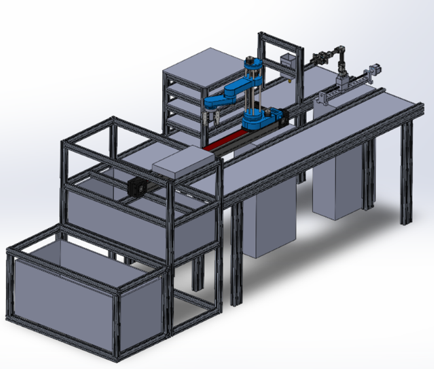
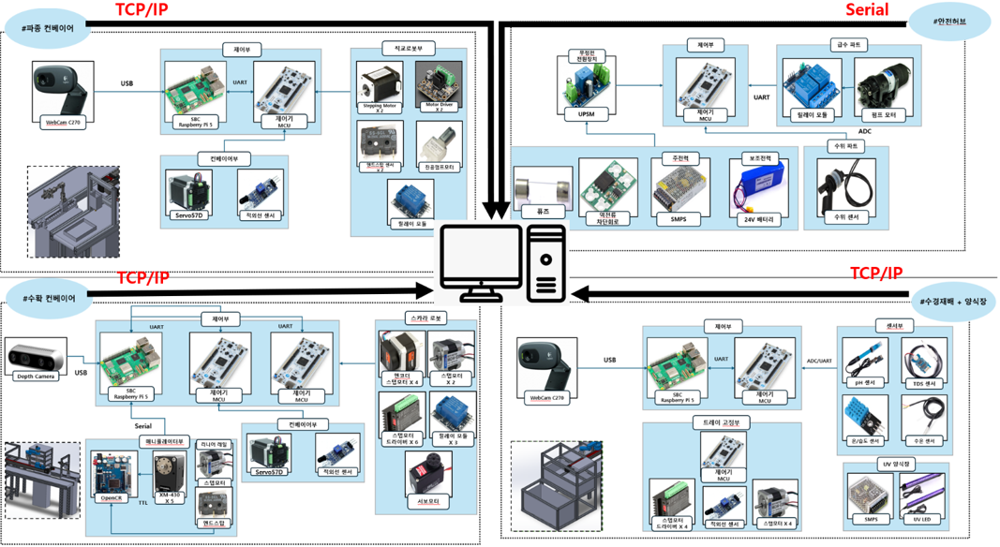
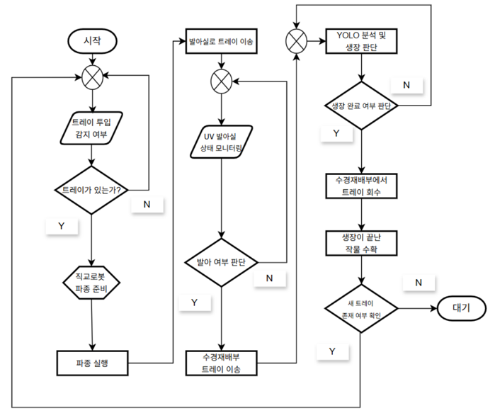

# 🐟🌱 자원순환형 AI 재배 공정 시스템

**Automated Aquaponics System**

> 2026 한이음 드림업 공모전 | 프로젝트 번호: 26_HC230

##  1. 프로젝트 개요

### 1-1. 프로젝트 소개

- **프로젝트 명** : 자원순환형 AI 재배 공정 시스템
- **프로젝트 정의** : 파종 → 발아 → 수경재배 → 수확까지 작물의 전 생육 과정을 컨베이어·로봇·비전으로 자동 이송하고, 카메라 및 수질·환경 센서로 양식장과 수경재배실을 모니터링하는 아쿠아포닉스 스마트팜 시스템
- 
<p align="center">
  <!-- 전체 시스템 3D 모델링 (가운데 정렬, 폭 450px) -->
  
</p>

### 1-2. 개발 배경 및 필요성

- 아쿠아포닉스는 물고기 양식수의 영양분으로 식물을 키우는 순환형 농업 방식이지만, 수질(pH·TDS·수온) 관리와 트레이 이동·수확 같은 반복 노동이 많아 운영 부담이 큽니다.
- 기존 소형 수경재배 제품은 대부분 ’재배 환경 제어’에 머물러 있고, 생육 단계 간 **트레이 이송과 수확**은 여전히 사람의 손에 의존합니다.
- 따라서 생육 단계별 공간(발아실·수경재배실)을 분리하고, 각 단계의 이동과 수확을 로봇이 담당하는 **공정형 자동화 스마트팜**을 구현하고자 했습니다.

### 1-3. 프로젝트 특장점

- 파종 컨베이어 → 발아실 → 수경재배실 → 진동부 → 수확 컨베이어로 이어지는 **전 공정 자동 이송**
- YOLO 기반 비전으로 **트레이 인식 및 발아(새싹) 상태 판단** 후 다음 공정으로 이송
- PC 마스터 노드가 각 재배실의 **슬롯 상태(빈 슬롯/생육 중/수확 가능 등)를 관리**하고 스카라 로봇 작업을 스케줄링
- ROS 2 기반 분산 구조 : PC 1대 + 라즈베리파이 3대 + 다수 MCU를 역할별로 분리
- 하트비트·통신 워치독·긴급정지(E-STOP)·리셋, 독립된 **안전허브(수위 감시·펌프 제어)** 로 이중 안전장치 구성

### 1-4. 주요 기능

- **자동 모드** : 트레이 인식 → 파종 → 발아실 적재 → 발아 완료 판단 → 수경재배실 이송 → 성장 완료 시 진동부·수확 컨베이어 → 매니퓰레이터 수확
- **수동 모드** : 터미널 명령으로 각 장치(컨베이어, 스카라, 매니퓰레이터)를 개별 제어
- **환경 모니터링** : pH, TDS, 기온·습도, 수온 측정 및 웹 대시보드 표시
- **안전 기능** : 수위 이상 감지, 펌프 제어, 장치별/전체 긴급정지 및 리셋
- **상태 모니터링** : 터미널 대시보드(monitor_node)와 Flask 웹 페이지로 장치 상태·플래그 확인

### 1-5. 기대 효과 및 활용 분야

- **기대 효과** : 생육 단계 이동·수확 등 반복 노동 절감, 센서 기반 수질 관리로 재배 안정성 향상
- **활용 분야** : 도시형·실내 스마트팜, 교육용 아쿠아포닉스 키트, 소규모 엽채류·새싹채소 생산

### 1-6. 기술 스택

- **통신/미들웨어** : ROS 2 (rclpy), UART 바이너리 프로토콜, TCP/IP 영상 스트리밍
- **PC / SBC** : Python, Ubuntu, Raspberry Pi ×3
- **AI / 비전** : YOLO (Ultralytics), PyTorch, OpenCV, Intel RealSense D435, Logitech C270
- **임베디드** : STM32F446 (STM32CubeIDE, HAL), Arduino Mega, OpenCR
- **구동부** : 스텝모터(직교로봇·컨베이어·스카라), Dynamixel 기반 OpenManipulator
- **센서** : pH, TDS, DHT22(기온·습도), DS18B20(수온), 수위센서, 엔드스탑, 엔코더
- **모니터링 웹** : Flask, HTML/CSS/JavaScript

##  2. 팀원 소개

| 멘티1 | 멘티2 | 멘티3 | 멘티4 | 멘토 |
|:---:|:---:|:---:|:---:|:---:|
| • 프로젝트 총괄<br>• SCARA 로봇<br>• 전장 | • 하드웨어 제작<br>• 기구 설계 | • STM32 펌웨어<br>• 컨베이어/직교로봇<br>• 전체 통신 | • 비전(YOLO)<br>• 웹 모니터링<br>• 매니퓰레이터 | • 프로젝트 멘토<br>• 기술 자문 |

##  3. 시스템 구성도



### 3-1. H/W 구성도

| 구역 | SBC | 연결 장치 |
| --- | --- | --- |
| 파종 컨베이어 | Pi1 | STM32(직교로봇·컨베이어1, 스텝모터·엔드스탑), C270 웹캠 |
| 수확 컨베이어 | Pi2 | STM32(컨베이어2), 스카라(Arduino Mega), 매니퓰레이터(OpenCR), D435 |
| 수경재배 + 양식장 | Pi3 | STM32 센서허브(pH·TDS·온습도·수온), C270 웹캠 |
| 안전허브 | – (PC 직결 Serial) | 수위센서, 릴레이, 펌프모터 |

### 3-2. 자동 공정 흐름도



### 3-3. 디렉토리 구조

```
├── ros_comm/            # ROS 2 패키지 (PC master_node, monitor_node / Pi1·Pi2·Pi3 노드)
├── first_convey/        # 파종 컨베이어: 직교로봇 펌웨어(STM32), 센서허브, 카메라 캘리브레이션
├── nursery/             # 발아실/수경재배실 센서허브(STM32), 트레이 제어(Arduino)
├── sec_convey/          # 수확 컨베이어(STM32), 매니퓰레이터(OpenCR)
├── stepmotor_test/      # 스카라 로봇 역기구학·PID 제어(Arduino)
├── safe_hub/            # 안전허브: 수위 감시, 펌프 제어, 긴급정지
└── Mentoring/           # 멘토링 기록
```

##  4. 작품 소개영상

[](https://www.youtube.com/watch?v=-y7UJgUn2j8)

##  5. 핵심 소스코드

### 5-1. UART 바이너리 프레임 생성 및 파싱 (`ros_comm/src/smartfarm_pi1/smartfarm_pi1/pi1_node.py`)

- **소스코드 설명** : 라즈베리파이와 STM32 간 명령/상태를 `SOF | ID | LEN | DATA | CHK` 형식의 바이너리 프레임으로 주고받습니다. 수신 측은 상태머신으로 한 바이트씩 해석하고, 체크섬이 맞는 프레임만 채택해 노이즈로 깨진 데이터를 걸러냅니다.

```python
# 프레임 생성: SOF(0xAA) | ID | LEN | DATA | CHK
def make_frame(pid: int, data: bytes = b'') -> bytes:
    length = len(data)
    chk    = (pid + length + sum(data)) & 0xFF   # 체크섬: 하위 1바이트
    return bytes([SOF, pid, length]) + data + bytes([chk])

class BinaryParser:
    """SOF 기준 상태머신으로 바이트 스트림을 프레임 단위로 파싱"""
    WAIT_SOF, WAIT_ID, WAIT_LEN, WAIT_DATA, WAIT_CHK = range(5)

    def feed(self, byte: int):
        if self.state == self.WAIT_SOF:
            if byte == SOF:
                self.state = self.WAIT_ID
        elif self.state == self.WAIT_ID:
            self.pid, self.state = byte, self.WAIT_LEN
        elif self.state == self.WAIT_LEN:
            self.length = byte
            if self.length > MAX_DATA_LEN:      # 비정상 길이 → 처음부터 다시
                self.state = self.WAIT_SOF
            elif self.length == 0:
                self.state = self.WAIT_CHK
            else:
                self.data, self.state = [], self.WAIT_DATA
        elif self.state == self.WAIT_DATA:
            self.data.append(byte)
            if len(self.data) >= self.length:
                self.state = self.WAIT_CHK
        elif self.state == self.WAIT_CHK:
            chk = (self.pid + self.length + sum(self.data)) & 0xFF
            if chk == byte:                     # 체크섬 일치 프레임만 저장
                self.frames.append((self.pid, bytes(self.data)))
            self.state = self.WAIT_SOF
```

### 5-2. 자동 모드 트레이 이송 스케줄링 (`ros_comm/smartfarm_ws/src/smartfarm_master/smartfarm_master/master_node.py`)

- **소스코드 설명** : 마스터 노드는 발아실·수경재배실의 각 슬롯 상태(`empty`, `growing`, `ready` 등)를 관리합니다. 수확 라인 정체를 막기 위해 **수경재배실의 수확 가능 트레이를 먼저** 내보내고, 그다음 발아 완료 트레이를 빈 수경 슬롯으로 이송하는 작업을 스카라 큐에 등록합니다.

```python
# ── 일반 자동 모드 ──
# 1순위: 수경실 READY 트레이 → 진동부/컨베이어2 (수확 라인 비우기)
water_source = self._find_ready_slot_locked('water')
if water_source is not None and self._is_c2_drop_available_locked():
    if self._queue_water_to_c2_locked(water_source):
        return

# 2순위: 발아실 READY 트레이 → 수경실 빈 슬롯
nursery_source    = self._find_ready_slot_locked('nursery')
water_destination = self._find_empty_slot_locked('water')
if nursery_source is not None and water_destination is not None:
    self._queue_nursery_to_water_locked(nursery_source, water_destination)
```

### 5-3. 스카라 로봇 역기구학 (`stepmotor_test/scara_pid/kinematic.cpp`)

- **소스코드 설명** : 2링크 스카라의 목표 좌표(x, y)로부터 두 관절 각도를 계산합니다. 도달 불가능한 좌표는 미리 걸러내고, 부동소수 오차로 `cos` 값이 ±1을 넘는 경우를 보정합니다.

```cpp
bool inverse2R(float x_mm, float y_mm, float L1_mm, float L2_mm,
               bool elbowUp, float &th1_deg, float &th2_deg)
{
  float r2 = x_mm*x_mm + y_mm*y_mm;
  float r  = sqrtf(r2);

  // 작업 영역 밖이면 실패 반환
  if (r > (L1_mm + L2_mm)) return false;
  if (r < fabsf(L1_mm - L2_mm)) return false;

  // 코사인 법칙으로 2번 관절 각도
  float c2 = (r2 - L1_mm*L1_mm - L2_mm*L2_mm) / (2.0f*L1_mm*L2_mm);
  if (c2 >  1.0f) c2 =  1.0f;   // 부동소수 오차 clamp
  if (c2 < -1.0f) c2 = -1.0f;

  float s2 = sqrtf(fmaxf(0.0f, 1.0f - c2*c2));
  if (elbowUp) s2 = -s2;        // 팔꿈치 방향 선택

  float th2 = atan2f(s2, c2);
  float th1 = atan2f(y_mm, x_mm) - atan2f(L2_mm*s2, L1_mm + L2_mm*c2);

  th1_deg = th1 * RAD_TO_DEG;
  th2_deg = th2 * RAD_TO_DEG;
  return true;
}
```
